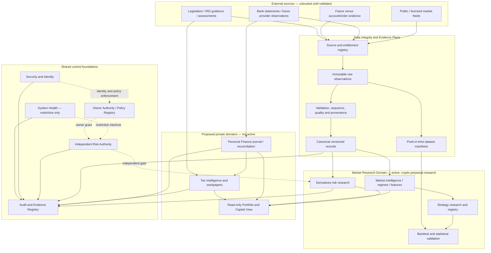
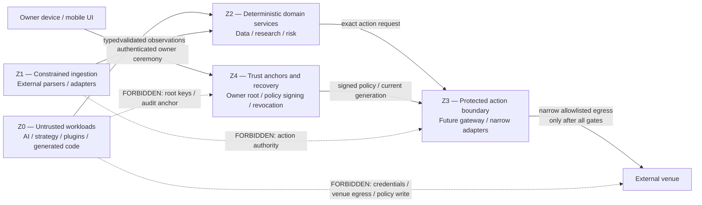
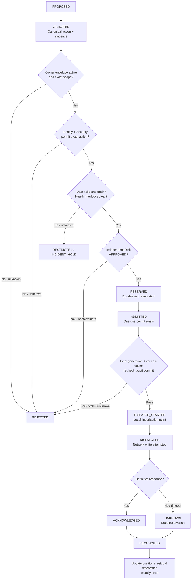
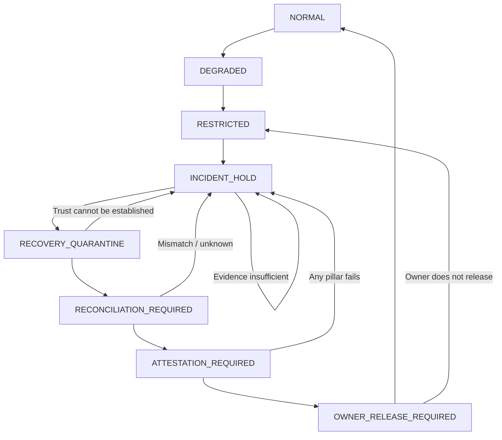
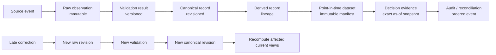

# IDEAL System Architecture Diagrams

**Status:** Phase 02 logical diagrams; provisional, technology-neutral  
**Checkpoint:** 082 — 17 November 2026  
**Authority:** D-020, D-021, D-022, D-023  
**Boundary:** Conceptual diagrams only. They do not select deployment, storage, API, network, technology or execution authority.

## 1. Domain and evidence flow

The proposed private domains are not activated. Portfolio/capital is a read-only projection; the diagram does not imply shared ledgers, cash, collateral, permissions or tax treatment.

## 2. Trust zones and forbidden flows

Logical zones are mandatory; physical separation is deployment-dependent. Same-host process/VM separation does not survive host-root/kernel compromise.

## 3. Consequential action admission and dispatch

The external venue is outside IDEAL's local ACID transaction. DISPATCH_STARTED means potentially in-flight; it does not prove venue receipt.

## 4. Incident and recovery lifecycle

Recovery requires external-state reconciliation, current revocation/identity state, audit/data integrity and scoped pillar attestations. A process restart or successful backup restore is not a recovery release.

## 5. Evidence and temporal lifecycle

The original as-known-then decision snapshot remains immutable. A late correction creates a new latest-known view and invalidates only dependent current calculations.

## 6. Diagram governance

These diagrams are conceptual and must be reconciled with final contracts, threat model, owner decisions and deployment topology before any implementation blueprint. The arrows show logical information/authority flow, not network routes or API endpoints. Dashed lines represent constrained authority or forbidden-flow concepts, not actual protocol choices.

No implementation, external integration, deployment, paper/live execution or phase advancement is authorised.
